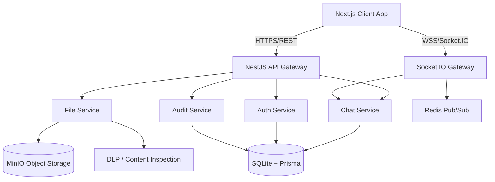

# Secure Healthcare Communication Platform Architecture

## 1. System Architecture Overview

The system follows a modern, decoupled microservices-inspired architecture designed for on-premise deployment within hospital networks, prioritizing security (HIPAA/PDPA principles), real-time performance, and auditability.



### Components:
*   **Frontend**: Next.js App Router (React), Zustand (State), React Query (Data Fetching), Socket.IO-client.
*   **Backend**: NestJS (Modular structure), Socket.IO (Real-time), Prisma (ORM).
*   **Data Layer**: SQLite (Primary DB), Redis (Session cache, Pub/Sub for WebSockets).
*   **Storage**: MinIO (On-premise S3-compatible storage for attachments).

---

## 2. Prisma Database Schema (`schema.prisma`)

```prisma
// This is your Prisma schema file,
// learn more about it in the docs: https://pris.ly/d/prisma-schema

generator client {
  provider = "prisma-client-js"
}

datasource db {
  provider = "sqlite"
  url      = env("DATABASE_URL")
}

model User {
  id               String       @id @default(uuid())
  username         String       @unique
  passwordHash     String
  firstName        String
  lastName         String
  professionalId   String?      // e.g., Medical License Number
  roleId           String
  isActive         Boolean      @default(true)
  createdAt        DateTime     @default(now())
  updatedAt        DateTime     @updatedAt
  deletedAt        DateTime?    // Soft delete

  role             Role         @relation(fields: [roleId], references: [id])
  devices          Device[]
  sessions         Session[]
  memberships      RoomMember[]
  sentMessages     Message[]    @relation("SentMessages")
  auditLogs        AuditLog[]
}

model Role {
  id          String       @id @default(uuid())
  name        String       @unique // Doctor, Nurse, Pharmacist, Admin, etc.
  description String?
  permissions Permission[]
  users       User[]
}

model Permission {
  id          String   @id @default(uuid())
  action      String   @unique // e.g., 'READ_CONFIDENTIAL', 'EXPORT_AUDIT'
  description String?
  roles       Role[]
}

model ChatRoom {
  id               String       @id @default(uuid())
  name             String?      // Nullable for 1-on-1 DM
  type             String       // 'DIRECT', 'GROUP', 'PATIENT_CONTEXT'
  patientContextId String?      @unique
  createdAt        DateTime     @default(now())
  updatedAt        DateTime     @updatedAt

  patientContext   PatientContext? @relation(fields: [patientContextId], references: [id])
  members          RoomMember[]
  messages         Message[]
}

model PatientContext {
  id         String    @id @default(uuid())
  hn         String    // Hospital Number
  an         String?   // Admission Number
  nameHash   String    // Hashed or encrypted patient name for search/display
  status     String    // 'ACTIVE', 'DISCHARGED'
  chatRoom   ChatRoom?
}

model RoomMember {
  id         String   @id @default(uuid())
  roomId     String
  userId     String
  joinedAt   DateTime @default(now())
  lastReadAt DateTime @default(now())
  role       String   @default("MEMBER") // 'ADMIN', 'MEMBER'

  room       ChatRoom @relation(fields: [roomId], references: [id])
  user       User     @relation(fields: [userId], references: [id])

  @@unique([roomId, userId])
}

model Message {
  id               String    @id @default(uuid())
  roomId           String
  senderId         String
  content          String    // Encrypted at application layer
  classification   String    // 'PUBLIC', 'INTERNAL', 'CONFIDENTIAL', 'RESTRICTED'
  replyToId        String?
  isPinned         Boolean   @default(false)
  createdAt        DateTime  @default(now())
  updatedAt        DateTime  @updatedAt
  deletedAt        DateTime?

  room             ChatRoom  @relation(fields: [roomId], references: [id])
  sender           User      @relation("SentMessages", fields: [senderId], references: [id])
  replyTo          Message?  @relation("Replies", fields: [replyToId], references: [id])
  replies          Message[] @relation("Replies")
  attachments      Attachment[]
}

model Attachment {
  id           String   @id @default(uuid())
  messageId    String
  fileName     String
  fileType     String
  fileSize     Int
  storageKey   String   // MinIO object key
  createdAt    DateTime @default(now())

  message      Message  @relation(fields: [messageId], references: [id])
}

model AuditLog {
  id        String   @id @default(uuid())
  userId    String?
  action    String   // 'LOGIN', 'MESSAGE_SENT', 'FILE_DOWNLOAD', 'DLP_TRIGGERED'
  entity    String   // 'Message', 'User', 'File'
  entityId  String?
  details   String   // JSON string of event details
  ipAddress String?
  userAgent String?
  createdAt DateTime @default(now())

  user      User?    @relation(fields: [userId], references: [id])
}

model Device {
  id         String   @id @default(uuid())
  userId     String
  deviceToken String  // For push notifications
  deviceType String   // 'iOS', 'Android', 'Web'
  lastActive DateTime @default(now())

  user       User     @relation(fields: [userId], references: [id])
}

model Session {
  id           String   @id @default(uuid())
  userId       String
  refreshToken String   @unique
  expiresAt    DateTime
  ipAddress    String?
  userAgent    String?
  createdAt    DateTime @default(now())

  user         User     @relation(fields: [userId], references: [id])
}
```

---

## 3. Folder Structure

### Backend (NestJS)
```text
server/
├── src/
│   ├── modules/
│   │   ├── auth/          # JWT, Refresh tokens, Roles
│   │   ├── users/         # Directory, Profiles
│   │   ├── chat/          # Rooms, Messages, REST endpoints
│   │   ├── realtime/      # Socket.IO Gateway, Redis Adapter
│   │   ├── storage/       # MinIO integration, Secure URLs
│   │   ├── audit/         # Audit logging interceptors/services
│   │   ├── dlp/           # Data Loss Prevention service
│   │   └── notification/  # Push, Email, In-app
│   ├── common/
│   │   ├── guards/        # JwtAuthGuard, RolesGuard
│   │   ├── interceptors/  # TransformInterceptor, AuditInterceptor
│   │   ├── filters/       # AllExceptionsFilter
│   │   └── utils/         # Crypto, Helpers
│   ├── prisma/            # Prisma service
│   └── main.ts
```

### Frontend (Next.js)
```text
client/
├── src/
│   ├── app/
│   │   ├── (auth)/        # Login, 2FA
│   │   ├── (dashboard)/   # Main layout
│   │   │   ├── chat/      # DM and Group views
│   │   │   ├── patient/   # Patient context views
│   │   │   └── admin/     # Admin dashboard
│   │   └── layout.tsx
│   ├── components/
│   │   ├── ui/            # shadcn/ui components
│   │   ├── chat/          # MessageBubble, ChatInput, Thread
│   │   ├── sidebar/       # RoomList, PatientList
│   │   └── shared/        # Avatar, Modals, StatusIndicator
│   ├── lib/
│   │   ├── api.ts         # Axios/Ky instances
│   │   ├── socket.ts      # Socket.IO client singleton
│   │   ├── store.ts       # Zustand store (UI state, Active Room)
│   │   └── utils.ts       # Tailwind merge, date formatting
│   └── hooks/
│       ├── use-chat.ts    # React Query hooks for messages
│       └── use-socket.ts  # Socket event listeners
```

---

## 4. API Structure (REST)

| Method | Endpoint | Description | Guard |
| :--- | :--- | :--- | :--- |
| POST | `/api/auth/login` | Authenticate and get JWT | Public |
| POST | `/api/auth/refresh` | Get new JWT using refresh token | Valid Refresh Token |
| GET | `/api/users/directory` | Get list of staff/users | JWT |
| GET | `/api/rooms` | Get user's chat rooms | JWT |
| POST | `/api/rooms` | Create a DM or Group room | JWT |
| GET | `/api/rooms/:id/messages` | Get paginated messages | JWT, RoomMember |
| POST | `/api/storage/upload-url` | Get pre-signed MinIO upload URL | JWT |
| GET | `/api/storage/download/:id`| Get temporary secure download URL | JWT, RoomMember, Audit |
| GET | `/api/admin/audit` | View audit logs | JWT, AdminRole |

---

## 5. Realtime Architecture & WebSocket Flow

**Gateway:** `chat.gateway.ts`
**Adapter:** Redis IoAdapter for multi-instance scaling.

### Event Flow: Sending a Message
1. **Client** types message and hits `Enter`.
2. **Client** emits `sendMessage` event with payload `{ roomId, content, classification }`.
3. **Gateway** receives event.
    * Validates JWT token.
    * Checks if user is a member of `roomId`.
    * Runs DLP check on `content` (If flagged -> Block/Warn, emit `dlpWarning`).
4. **Service** saves message to DB (Prisma).
5. **Gateway** broadcasts `newMessage` to `room_${roomId}`.
6. **Gateway** updates `lastReadAt` for sender.
7. **Gateway** triggers push notification job for offline users.

### Essential WebSocket Events
*   `subscribe`: Client joins rooms (`socket.join('room_123')`).
*   `sendMessage`: Client sends a message.
*   `newMessage`: Server broadcasts to room.
*   `typing`: Client emits typing status.
*   `displayTyping`: Server broadcasts typing indicator.
*   `messageRead`: Client acknowledges reading up to a message ID.

---

## 6. Security Architecture & DLP Middleware

### DLP (Data Loss Prevention) Pipeline
All incoming messages and text file uploads pass through the `DlpService`.

```typescript
// dlp.service.ts
export class DlpService {
  private readonly patterns = {
    thaiId: /\b[1-9]\d{12}\b/,
    phone: /\b0\d{9}\b/,
    hn: /\bHN-\d{6}\b/,
  };

  analyze(content: string): { flagged: boolean; reason?: string } {
    if (this.patterns.thaiId.test(content)) return { flagged: true, reason: 'THAI_ID' };
    if (this.patterns.hn.test(content)) return { flagged: true, reason: 'HOSPITAL_NUMBER' };
    return { flagged: false };
  }
}
```

### Security Measures
1. **Data at Rest**: SQLite file must be on an encrypted volume (LUKS/BitLocker). Application-layer encryption for message `content`.
2. **Data in Transit**: Enforce TLS 1.2+ for all API and WSS traffic.
3. **Authentication**: Short-lived JWTs (15m) + HttpOnly secure cookies for refresh tokens.
4. **Authorization**: Strict RBAC checking in guards (`@Roles('DOCTOR', 'NURSE')`).
5. **File Security**: Files are NOT served statically. Clients must request a short-lived Signed URL from MinIO via the API, which logs the access.

---

## 7. Audit Architecture

The `AuditService` acts asynchronously via events (`EventEmitter2`) to prevent blocking the main request thread.

```typescript
// audit.interceptor.ts
@Injectable()
export class AuditInterceptor implements NestInterceptor {
  constructor(private eventEmitter: EventEmitter2) {}

  intercept(context: ExecutionContext, next: CallHandler): Observable<any> {
    const req = context.switchToHttp().getRequest();
    
    return next.handle().pipe(
      tap(() => {
        this.eventEmitter.emit('audit.log', {
          userId: req.user?.id,
          action: req.method === 'GET' ? 'READ' : 'WRITE',
          entity: req.route.path,
          ipAddress: req.ip,
        });
      }),
    );
  }
}
```

---

## 8. File Upload Workflow

1. **Client** selects file.
2. **Client** requests signed upload URL: `POST /api/storage/upload-url { fileName, size, roomId }`.
3. **Server** validates size/type, creates DB `Attachment` record (status: pending), and returns MinIO Presigned PUT URL.
4. **Client** uploads directly to MinIO (bypassing Node.js server memory).
5. **Client** notifies server: `POST /api/messages { ...roomId, attachmentId }`.
6. **Server** marks attachment complete, links to message, broadcasts `newMessage`.

---

## 9. Example Environment Variables (`.env`)

```env
# Server
PORT=3000
NODE_ENV=production

# Database
DATABASE_URL="file:./data/hospital_chat.db"

# Redis (Realtime Pub/Sub)
REDIS_HOST=localhost
REDIS_PORT=6379

# Security
JWT_SECRET="super-secure-256-bit-key"
JWT_EXPIRATION="15m"
REFRESH_TOKEN_SECRET="another-secure-key"
ENCRYPTION_KEY="32-byte-key-for-message-encryption"

# MinIO (Storage)
MINIO_ENDPOINT=play.min.io
MINIO_PORT=9000
MINIO_ACCESS_KEY=your-access-key
MINIO_SECRET_KEY=your-secret-key
MINIO_BUCKET_NAME=hospital-chat-attachments
```

---

## 10. Deployment Guide (On-Premise)

For hospital environments, Docker Compose or a lightweight Kubernetes (K3s) setup is recommended to ensure data stays within the intranet.

1. **Infrastructure**: Provision a Linux VM behind the hospital firewall.
2. **Reverse Proxy**: Setup Nginx or Traefik to handle SSL termination and route `/api` to NestJS and `/socket.io` to the WebSocket gateway.
3. **Storage**: Mount a persistent, encrypted volume for SQLite `data/` and MinIO storage directories.
4. **Scaling**: If deploying multiple NestJS instances, ensure Redis is configured for Socket.IO adapter so broadcasts reach users connected to different nodes.
5. **Monitoring**: Export logs to the hospital's central SIEM (e.g., Splunk, Elastic) for compliance auditing.
